# 👋 Hi, I'm Mohamed Sami

### 🚀 Backend Developer | Java & Spring Boot | Python & FastAPI

🎓 Computer Engineering Student  
📍 Egypt  
🌍 Open to International Opportunities

---

## 🧠 About Me

I'm a Backend Developer focused on building reliable, secure, and maintainable backend systems.

My primary stack is **Java and Spring Boot**, and I also work with **Python and FastAPI**, alongside Node.js and Express.js.

I enjoy going beyond basic CRUD operations and exploring how real-world backend systems are designed, structured, and scaled.

My interests include:

- Backend Architecture & System Design
- Event-Driven Architecture & Distributed Systems
- Database Design & Optimization
- Authentication & Application Security
- Asynchronous Processing & Messaging Systems
- Real-time Communication
- Containerization & CI/CD

I believe good backend engineering is not just about making things work, but understanding why they work and how they behave in real-world environments.

---

## 🛠 Tech Stack

### 💻 Programming Languages

### ⚙️ Backend Development

### 🏗 Architecture & Backend Concepts

- RESTful API Design
- Object-Oriented Programming (OOP)
- SOLID Principles
- Layered Architecture
- Event-Driven Architecture
- Transactional Outbox Pattern
- Asynchronous Processing
- Database Transactions & Concurrency
- Authentication & Authorization
- JWT (RS256), Access & Refresh Tokens
- WebSocket, STOMP & SockJS
- Retry Mechanisms & Dead Letter Queues

### 🗄 Databases & Messaging

### 🐳 DevOps & Development Tools

### 🧪 Testing

- JUnit 5
- Mockito
- Spring Boot Test
- Testcontainers
- Integration Testing

### 🌐 Frontend Technologies

---

## 🚀 Projects & Practical Experience

### ⚽ Kawera — Sports Platform

Working on backend development for a sports platform using **Java, Spring Boot, and a multi-service architecture**.

Some of the technical challenges and implementations I've worked on:

- Designing RESTful APIs and backend business logic.
- Implementing secure authentication using RS256 JWTs and HttpOnly Cookies.
- Building real-time communication using WebSocket, STOMP, and SockJS.
- Applying Event-Driven Architecture with RabbitMQ.
- Implementing the Transactional Outbox Pattern for reliable event publishing.
- Integrating MySQL, MongoDB, and Redis.
- Building asynchronous event processing with retry mechanisms and Dead Letter Queues.
- Writing automated tests using JUnit, Mockito, and Testcontainers.
- Containerizing application services using Docker and Docker Compose.
- Working with database transactions and consistency across application components.

---

## 📚 Currently Learning & Improving

- Advanced Java & Spring Boot
- Python & FastAPI
- System Design & Distributed Systems
- Microservices Architecture
- Docker & Kubernetes
- CI/CD with GitHub Actions
- Data Structures & Algorithms
- Problem Solving
- Technical English & Communication

---

## 📊 GitHub Statistics

  
  

  

---

## 📫 Connect With Me

  
  
  

---

## 🤝 Let's Build Something Great

I'm always interested in learning, collaborating, and building meaningful software.

Feel free to explore my repositories or connect with me!
